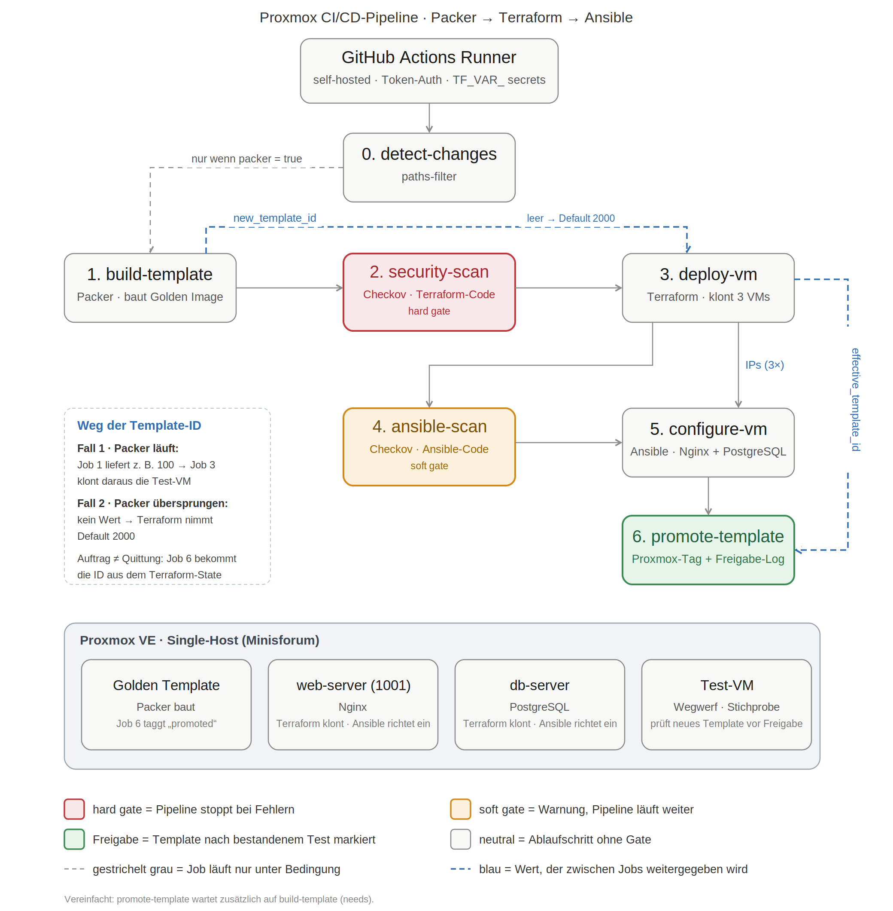

# 🚀 Self-Hosted-Infrastruktur auf Proxmox – IaC, Security-Gate und Cyber Range

> Automatisierte Infrastructure-as-Code Pipeline mit Packer, Terraform, Ansible, GitHub Actions und Checkov Custom Policy Checks

> **In drei Sätzen**
>
> 1. Ich baue Server nicht von Hand, sondern beschreibe sie als Code – ein Programm baut sie danach automatisch, jedes Mal gleich und nachvollziehbar.
> 2. Vor jedem Einsatz prüft das System den Bauplan automatisch auf Sicherheitslücken. Gezielte Angriffe auf meine eigenen Server zeigen, ob die Abwehr hält – die Angriffe werden von mir als „Sicherheitsanalyst“ dokumentiert.
> 3. Das Projekt orientiert sich damit an dem, was die EU-Verordnung DORA von Banken verlangt: IT-Systeme schützen, Angriffe erkennen und die Widerstandsfähigkeit regelmäßig testen.


---

## 📋 Inhaltsverzeichnis

- [Projektübersicht](#-projektübersicht)
- [Bezug zu DORA](#-bezug-zu-dora)
- [Cyber Range](#-cyber-range)
- [Technologie-Stack](#-technologie-stack)
- [Projektstruktur](#-projektstruktur)
- [Vertiefungen und Betrieb](#-architektur-vertiefungen)
- [Installation & Setup](#-installation--setup)
- [Nutzung](#️-nutzung)
- [Bekannte technische Schuld](#️-bekannte-technische-schuld-offen)
- [Roadmap - Stand und nächste Schritte](#️-roadmap-stand-und-nächste-schritte)
- [Zukunftsausblick](#-zukunftsausblick-ai-driven-siem--monitoring)

---

## 🎯 Projektübersicht

**Leitidee: Ich baue sichere Infrastruktur per IaC, greife sie an, erkenne die Angriffe und dokumentiere sie.**



Dieses Projekt automatisiert die sichere Bereitstellung einer vollständigen Infrastruktur auf Proxmox VE mittels Infrastructure-as-Code (IaC). Ein hartes Security-Gate (Terraform-Seite) sowie ein ergänzendes Soft-Gate (Ansible-Seite) verhindern bzw. dokumentieren fehlerhafte Deployments.

| Komponente | Aufgabe |
|------------|---------|
| **Packer** | Erstellt ein Ubuntu 22.04 Golden-Image-Template (Cloud-Image-basiert, `proxmox-clone`-Builder) |
| **Terraform** | Provisioniert zwei VMs auf Proxmox mittels `bpg/proxmox` Provider: Web-Server und DB-Server |
| **Checkov** | Validiert IaC auf Security-Policies **vor** dem Deploy (Terraform: hartes Gate, Ansible: Soft-Gate) |
| **Ansible** | Konfiguriert die VMs: Nginx auf dem Web-Server, PostgreSQL auf dem DB-Server (inkl. Netzwerkzugriffskonfiguration zwischen beiden) |
| **GitHub Actions** | Automatisiert die komplette Pipeline inkl. beider Security-Gates (self-hosted Runner) |

Das Projekt wächst in aufeinander aufbauenden Phasen (2A, 2B, 2C, 3 …) – Stand und nächste Schritte: [🗺️ Roadmap](#️-roadmap-stand-und-nächste-schritte).

[↑ Nach oben](#-inhaltsverzeichnis)

---

## 🏦 Bezug zu DORA

Der **Digital Operational Resilience Act (DORA, EU-Verordnung 2022/2554)** gilt seit dem 17.01.2025 für Banken und Finanzunternehmen. Er verlangt, dass IT-Systeme geschützt, Vorfälle erkannt und die Abwehr regelmäßig getestet wird.

Dieses Projekt ist ein privates Lernprojekt und **orientiert sich an den Prinzipien von DORA**. Die Tabelle zeigt, welche Bausteine zu welcher DORA-Säule passen:

| DORA-Säule | Was DORA verlangt | Umsetzung im Projekt | Stand |
|---|---|---|---|
| **IKT-Risikomanagement** | Systeme schützen, Schwachstellen vermeiden | Gehärtetes Golden Image ([CIS-Härtung](docs/cis-hardening.md)) · Security-Gate vor jedem Deploy ([Checkov](docs/security-gates.md)) · eigener Zugangs-Token pro Pipeline-Job, minimale Rechte ([Authentifizierung](docs/authentication.md)) | ✅ umgesetzt |
| **Vorfallmanagement** | Vorfälle erkennen, einstufen, dokumentieren | Ereignisse aus der [Cyber Range](#-cyber-range) als Incident-Ticket mit Einstufung (Classification, Severity) – [Berichte](docs/soc/README.md) | 🔶 begonnen |
| **Resilienztests** | Regelmäßig testen, ob die Abwehr hält | Neues Template wird erst nach erfolgreichem Testlauf freigegeben (Promotion) · Angriffe in der [Cyber Range](#-cyber-range): Portscan durchgeführt, SSH-Brute-Force geplant | 🔶 teilweise |
| **Drittparteirisiko** | Abhängigkeit von Dienstleistern beherrschen | HCP Terraform und GitHub als externe Dienste bewusst eingeordnet · Ausweg bei Anbieterausfall: State-Sicherung per `terraform state pull` ([Details](docs/konfiguration.md#terraform-state-in-hcp-terraform-phase-3)) | 🔶 manuell, Automatisierung geplant |

[↑ Nach oben](#-inhaltsverzeichnis)

---

## 🔍 Cyber Range

**Cyber Range – das Übungsgelände für Angriff und Abwehr**

Die Pipeline baut die Infrastruktur. Die Cyber Range ist der Übungsraum darin: Ein Angreifer-System (Kali Linux, eigenes VLAN) greift eigene Ziel-VMs aus der Pipeline an, Erkennungswerkzeuge zeichnen auf und werten aus, jeder Angriff wird dokumentiert.

| Schritt | Thema | Werkzeuge | Stand |
|---|---|---|---|
| S1 | Netzwerkpakete lesen | `tcpdump`, Wireshark | ✅ abgeschlossen |
| S2 | Portscan Angreifer → Web-Server | `nmap`, Wireshark | ✅ durchgeführt, Bericht in Arbeit |
| S4 | Angriffserkennung per Regeln (Installation per Ansible) | Suricata | 🔜 geplant |
| S4b | Verbindungsprotokolle auswerten | Zeek | 🔜 geplant |
| S4c | Regeln und Alarme vergleichen | Snort | 🔶 Einstieg über TryHackMe |
| S3 | SSH-Brute-Force, ausgewertet als Incident-Ticket | alle drei Werkzeuge | 🔜 geplant |
| S5 | Angriffe einordnen | MITRE ATT&CK | 🔶 begonnen (ATT&CK-Zeile in jedem Ticket) |
| S4d | Zentrale Auswertung der Host-Logs (statt SecurityOnion) | Wazuh | 🔜 geplant |

**Brücke zu IaC:** Die Erkennungswerkzeuge werden per **Ansible** installiert. Befunde aus der Cyber Range fließen als Härtung zurück ins Golden Image – Kreislauf: *Schwachstelle finden → per IaC härten → in der Pipeline prüfen → erneut angreifen.*

**Berichte:** alle Übungen nummeriert in der [Timeline der Cyber Range](docs/soc/README.md) – jede als Incident-Ticket mit MITRE-ATT&CK-Zuordnung.

**Lernnachweis:** TryHackMe, Pfad *SOC Level 1* (in Arbeit).

**Grundsätze:** Angriffe nur gegen eigene VMs im eigenen Netz · keine Mitschnitte (`.pcap`) und keine Zugangsdaten im Repo.

[↑ Nach oben](#-inhaltsverzeichnis)

---

## 🛠 Technologie-Stack

| Tool | Version | Zweck |
|------|---------|-------|
| Packer | 1.9+ (Proxmox-Plugin gepinnt auf `1.1.8`) | Template-Erstellung |
| Terraform | 1.5+ | Infrastructure Provisioning |
| HCP Terraform | Free-Tarif | Zentraler Speicher für den Terraform-State (versioniert, mit Locking) – seit Phase 3 |
| Checkov | 3.3.6 | Policy-as-Code Security-Scanning (Terraform- und Ansible-Framework) |
| Ansible | 2.14+ | Configuration Management |
| PostgreSQL | 14 (Ubuntu-22.04-Standardversion) | Datenbank auf dem DB-Server |
| Proxmox VE | 9.x | Virtualisierungsplattform |
| Ubuntu | 22.04 LTS | Betriebssystem (Cloud-Image) |

[↑ Nach oben](#-inhaltsverzeichnis)

---

## 📁 Projektstruktur

### Hauptverzeichnis
- **`.github/workflows/pipeline.yml`** - GitHub Actions Pipeline mit beiden Security-Gates
- **`README.md`** - Diese Projektübersicht
- **`docs/`** - Vertiefende Architektur-Dokumentation (siehe unten)

### Packer
- **`packer/ubuntu-2204.pkr.hcl`** - Packer Template (`proxmox-clone`-Builder)
- **`packer/setup-base-image.sh`** - Reproduzierbarer Aufbau der Cloud-Image-Basis-VM
- **`packer/_archiv-iso-ansatz/`** - Archivierter, verworfener ISO/Subiquity-Ansatz (Dokumentationszweck)

### Terraform
- **`terraform/main.tf`** - VM-Definitionen: `web_server` und `db_server`
- **`terraform/provider.tf`** - Provider & API-Konfiguration, dazu der `cloud`-Block (Speicherort des States in HCP Terraform, seit Phase 3)
- **`terraform/variables.tf`** - Variablendeklaration (getrennte Abschnitte je VM)
- **`terraform/outputs.tf`** - Ausgaben für Ansible (`vm_ip`, `db_server_ip`, u. a.)
- **`terraform/checks/`** - Custom Checkov Security Checks (`CKV_PROXMOX_1/2/3`)
- **`terraform/terraform.tfvars.example`** - Variablen-Vorlage

### Ansible
- **`ansible/inventory.ini`** - Wird pro Pipeline-Lauf dynamisch aus beiden Terraform-Output-IPs erzeugt
- **`ansible/playbook.yml`** - Zwei eigenständige Plays: Web-Server (Nginx) und DB-Server (PostgreSQL)
- **`ansible/checks/task/`** - Custom Checkov Security Check für Ansible-Tasks (`CKV_ANSIBLE_CUSTOM_1`)

[↑ Nach oben](#-inhaltsverzeichnis)

---

## 📚 Architektur-Vertiefungen

Diese README hält sich bewusst kurz. Wer tiefer in einzelne Entscheidungen einsteigen will, findet die ausführlichen Erklärungen hier:

| Thema | Kurzbeschreibung | Vertiefung |
|---|---|---|
| **Security-Gates** | Zwei Checkov-Gates (hart/weich), Custom Checks, `checkov:skip`-Prinzip | [`docs/security-gates.md`](docs/security-gates.md) |
| **CIS-Härtung (Phase 2B)** | Golden-Image-Härtung: SSH, Firewall, Updates, Dienste | [`docs/cis-hardening.md`](docs/cis-hardening.md) |
| **DB-Server (Phase 2C)** | Drei-Ebenen-Netzwerkmodell (Firewall/Lauschen/Zugriffsregel) | [`docs/db-server-architecture.md`](docs/db-server-architecture.md) |
| **Authentifizierung** | Dual-Auth Proxmox-API + getrennte SSH-Key-Architektur (Build/Produktiv) | [`docs/authentication.md`](docs/authentication.md) |

**Betrieb:**

| Thema | Kurzbeschreibung | Vertiefung |
|---|---|---|
| **Voraussetzungen** | Proxmox, Runner, HCP Terraform, benötigte GitHub Secrets | [`docs/voraussetzungen.md`](docs/voraussetzungen.md) |
| **Konfiguration** | Stellschrauben in Terraform, Terraform-State in HCP Terraform (Phase 3) | [`docs/konfiguration.md`](docs/konfiguration.md) |
| **Fehlerbehebung** | Typische Fehlerbilder mit Ursache und Lösung | [`docs/fehlerbehebung.md`](docs/fehlerbehebung.md) |

[↑ Nach oben](#-inhaltsverzeichnis)

---

## 🔧 Installation & Setup

1. Repository auf den self-hosted Runner klonen
2. Basis-Image einmalig aufbauen:
   ```bash
   chmod +x packer/setup-base-image.sh
   ./packer/setup-base-image.sh
   ```
   Erstellt die Cloud-Image-Basis-VM (Standard: ID `9000`), inkl. Disk-Vergrößerung und Guest-Agent-Flag.
3. Zwei Terraform-Variablen-Dateien anlegen:
   - `terraform/terraform.tfvars` (unkritische Werte: Netzwerk, IPs, Disk-Größe, `template_vm_id`) aus `terraform.tfvars.example`
   - `terraform/secrets.auto.tfvars` (nur die drei Proxmox-Auth-Werte: `pm_api_url`, `pm_api_token_id`, `pm_api_token_secret`) – wird von Terraform automatisch geladen, `.gitignore`-geschützt
4. HCP Terraform einrichten (siehe [Voraussetzungen](docs/voraussetzungen.md)): Workspace anlegen, Execution Mode **Local**, Team-Token erzeugen. Existiert bereits ein lokaler State, wird er **einmalig** nach HCP umgezogen – erst sichern, dann `terraform init` im Ordner mit State und `cloud`-Block, Rückfrage mit `yes` beantworten (Details: [Konfiguration](docs/konfiguration.md))
5. GitHub Secrets im Repo hinterlegen (siehe [Voraussetzungen](docs/voraussetzungen.md))
6. Self-hosted Runner registrieren und mit dem Label `proxmox` versehen
7. Push auf `main` (oder Pull Request) startet die Pipeline automatisch

[↑ Nach oben](#-inhaltsverzeichnis)

---

## ▶️ Nutzung

Ein Push auf `main` löst die Pipeline mit sieben aufeinander aufbauenden Jobs aus:

```
detect-changes          → Erkennt geänderte Verzeichnisse (packer/terraform/ansible)
build-template          → Packer baut/erneuert das Golden-Image-Template (nur bei Packer-Änderung)
security-scan           → Checkov-Gate, Terraform (hart) – Stop bei Verstoß
deploy-vm               → Terraform provisioniert Web-Server UND DB-Server
ansible-security-scan   → Checkov-Gate, Ansible (weich) – Report, kein Stop
configure-vm            → Ansible konfiguriert Nginx und PostgreSQL
promote-template        → Gibt ein neues Template nach erfolgreichem Testlauf frei und protokolliert es
```

`build-template` läuft nur, wenn `detect-changes` eine Änderung im `packer/`-Verzeichnis (oder an `pipeline.yml` selbst) erkennt – bei reinen Terraform-/Ansible-Änderungen wird der Job übersprungen.

Der Fortschritt ist im GitHub-Actions-Tab des Repos einsehbar. Schlägt `security-scan` fehl, werden die folgenden vier Jobs gar nicht erst gestartet ("Skipped", 0 Sekunden Laufzeit). Schlägt dagegen `ansible-security-scan` fehl, läuft `configure-vm` trotzdem an (Soft-Gate).

Nach einem erfolgreichen Lauf sind beide VMs über ihre von Terraform ausgegebenen IPs erreichbar (`terraform output -raw vm_ip` bzw. `terraform output -raw db_server_ip`). Da der State seit Phase 3 in HCP Terraform liegt, braucht dafür auch ein manueller Aufruf im Terminal eine Anmeldung (`terraform login`) und einen Ordner mit `cloud`-Block nach `terraform init`.

[↑ Nach oben](#-inhaltsverzeichnis)

---

## ⚠️ Bekannte technische Schuld (offen)

Transparent dokumentiert statt verschwiegen, analog zum `checkov:skip`-Prinzip:

**Ports 80/443 im Golden Image gelten für jede geklonte VM, unabhängig von der Rolle.** Der Packer-Provisioner öffnet UFW-Ports 22/80/443 einmalig im Template (Phase 2B). Für den DB-Server sind das zwei unnötig offene Ports (Verstoß gegen minimale Angriffsfläche) – noch keine Entscheidung getroffen, ob die Ports generell aus dem Template entfernt werden oder rollenspezifische VMs sie aktiv wieder schließen. Details: [`docs/cis-hardening.md`](docs/cis-hardening.md).

**Nginx-Healthcheck läuft bewusst über HTTP, nicht HTTPS.** Der Ansible-Task `Prüfen ob Nginx auf Port 80 antwortet` löst `CKV2_ANSIBLE_1` ("Ensure that HTTPS url is used with uri") im Soft-Gate `ansible-security-scan` aus – TLS ist für den Webserver aktuell nicht eingerichtet, der Check auf Port 80 ist beabsichtigt. Der Job scheitert dadurch reproduzierbar mit Exit-Code 1, `configure-vm` läuft trotzdem an (Soft-Gate-Prinzip). Keine Entscheidung getroffen, ob künftig TLS eingeführt oder der Check gezielt per `checkov:skip` unterdrückt wird.

**Der Pipeline-Token für HCP Terraform hat mehr Rechte als nötig.** Im Free-Tarif gibt es nur das Team `owners`; der Team-Token in `TF_API_TOKEN` hat damit volle Rechte in der Organisation, nicht nur auf den Workspace `02-CI-CO-VM` (Verstoß gegen Least Privilege). Im Betrieb würde man ein eigenes Team mit Rechten nur auf diesen Workspace anlegen. Der Token läuft nach 90 Tagen ab (**12.01.2027**) und muss rechtzeitig erneuert und im Secret ersetzt werden (Rotation).

[↑ Nach oben](#-inhaltsverzeichnis)

---

## 🗺️ Roadmap: Stand und nächste Schritte

Das Projekt wächst in aufeinander aufbauenden Phasen Richtung Enterprise-Reife. Die Tabelle zeigt den ganzen Weg: was abgeschlossen ist, was als Nächstes kommt und was geplant ist. Die Spalte **DORA-Säule** zeigt, auf welchen Teil des [DORA-Bezugs](#-bezug-zu-dora) ein Schritt einzahlt.

| Phase | Thema | Kernidee | DORA-Säule | Status |
|---|---|---|---|---|
| **2A** | Security-Gate (Checkov) | Statische IaC-Analyse **vor** dem Deploy: hartes Gate für Terraform, weiches Gate für Ansible, eigene Custom Checks – [Details](docs/security-gates.md) | IKT-Risikomanagement | ✅ abgeschlossen |
| **2B** | CIS-Härtung des Golden Images | Härtung **einmal** im Packer-Template statt pro VM (SSH, Firewall, Updates, Dienste); neues Template erst nach erfolgreichem Testlauf freigegeben (Promotion) – [Details](docs/cis-hardening.md) | IKT-Risikomanagement, Resilienztests | ✅ abgeschlossen |
| **2C** | Zweite VM (DB-Server) | PostgreSQL-VM aus dem gehärteten Image, Netzwerkzugriff Web-Server → DB-Server über drei Ebenen (Firewall, Lauschen, Zugriffsregel) – [Details](docs/db-server-architecture.md) | IKT-Risikomanagement | ✅ abgeschlossen |
| **3** | State-Backend (HCP Terraform) | Zentraler, versionierter und gesperrter Terraform-State statt lokaler `.tfstate`-Datei – [Details](docs/konfiguration.md#terraform-state-in-hcp-terraform-phase-3) | Drittparteirisiko | ✅ abgeschlossen |
| **3+** | Härtung aus SOC-Befund | Befund aus der Cyber Range (Root-Login per SSH) wird per Packer im Golden Image geschlossen und in der Pipeline geprüft (Test auf der VM + Custom Checkov Check) | IKT-Risikomanagement, Resilienztests | ⏳ als Nächstes |
| **4** | Dynamisches Inventar | Ansible fragt Proxmox live nach existierenden VMs ab, statt IPs manuell in `inventory.ini` zu pflegen – keine VM wird vergessen | IKT-Risikomanagement | 🔜 danach |
| **5** | Secrets-Management (Vault) | Ablösung von Klartext-Secrets durch HashiCorp Vault, inkl. VM-spezifischer Zugangsdaten | IKT-Risikomanagement | 🔜 geplant |
| **6** | Compliance & Doku-Automatisierung | `terraform-docs`/`ansible-doc` generieren Teile dieser Dokumentation künftig automatisch | IKT-Risikomanagement | 🔜 geplant |
| **parallel** | [Cyber Range](#-cyber-range) | Eigene VMs angreifen, Angriffe mit Suricata, Zeek, Snort und Wazuh erkennen, als Incident-Ticket dokumentieren | Resilienztests, Vorfallmanagement | 🔶 läuft |

**Nach Phase 6:**
- **Wiederkehrender Packer-Build** – neue Sicherheits-Patches fließen automatisch und regelmäßig ins Golden Image
- **Kubernetes im Kleinen** – k3s auf einer eigenen VM aus dem gehärteten Golden Image
- **Cloud-Plattform** – dieselben Prinzipien auf AWS oder Azure
- **Zertifizierung** – HashiCorp Terraform Associate

[↑ Nach oben](#-inhaltsverzeichnis)

---

## 🚀 Zukunftsausblick: AI-Driven SIEM & Monitoring

Aufbauend auf den IaC-Phasen und der [Cyber Range](#-cyber-range) wird das Framework um eine zentrale, automatisierte Sicherheitsüberwachung (SOC-in-a-Box) erweitert:

- **Automated Deployment:** Ansible-gestützte Instanziierung eines zentralen Log-Clusters (**Grafana / OpenSearch**)
- **Data Pipeline:** Automatisierter Versand von System- und Netzwerktracks (via Promtail/Beats) an das zentrale SIEM
- **AI-Driven Analytics:** Eigenständige Python-Pipeline (**Pandas**) zur Anomalie-Erkennung in Log-Strukturen
- **Automated Reporting:** LLM-gestützte Kontext-Evaluierung von Sicherheitsvorfällen, Generierung von *Executive Security Compliance Reports*

[↑ Nach oben](#-inhaltsverzeichnis)
